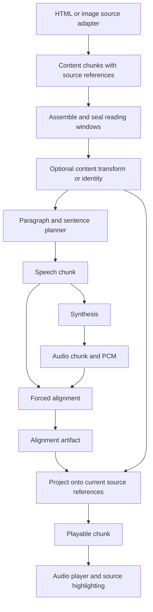

# Article Voice pipeline contracts

The version 1 wire shapes are in [contracts.schema.json](../pipeline/contracts.schema.json),
with [examples](../pipeline/examples.json), [TypeScript declarations](../src/pipeline/contracts.d.ts)
and the [source adapter interface](../src/sources/contracts.d.ts). JavaScript and Python
validate artifact identities, ranges and bindings at their boundaries. The JSON Schema
uses Draft 2020-12; UTF-16 coverage and cross-artifact constraints are checked by the
runtime parsers because ordinary schema length constraints count Unicode code points.

## Artifact rules

Every artifact has `schemaVersion: 1`, a discriminating `kind`, and an `id`.
The ID is SHA-256 of canonical JSON containing all fields except `id`: object
keys sorted recursively, array order retained, UTF-8 encoding, no insignificant
whitespace. It identifies an immutable value. JavaScript constructors/parsers
freeze the value; parsers on both sides recompute its identity. A transformation
creates a new artifact and retains its parent ID. An identity transform returns
the original artifact.

Text ranges use UTF-16 code units, with an inclusive `start` and exclusive `end`.
Audio ranges use sample positions in the declared playback sample rate. No stage
interprets a displayed time string, DOM selector or OCR rectangle as an identity.

| Artifact | Required facts |
| --- | --- |
| `ContentChunk` | Stream and sequence, parent IDs, `draft`/`sealed` stability, text, paragraph ranges and complete source mapping |
| `SpeechChunk` | Parent content ID, sequence within the content, exact text and digest, range in the content, planner policy |
| `AudioChunk` | Exact text digest, PCM digest, 24 kHz mono signed 16-bit format, frame count, voice reference, model and generation identities |
| `Alignment` | Audio ID and text digest, playback sample rate/frame count, measured sample intervals, text ranges or explicit `null`, unmapped text ranges, aligner revision |
| `PlayableChunk` | Content/speech/audio/alignment IDs and measured words projected onto this source's references |

Formatting preserves the stream, sequence, seal state and original source bounds.
A transform cannot introduce an unrelated page or source revision.

A source reference contains `unitId`, `revision`, `block`, `start`, and `end`.
The adapter retains the corresponding DOM positions or OCR boxes in Chrome.
The source map covers prepared text in order. An identity mapping has one source
range of equal length. A repaired span may map to multiple original fragments;
inserted punctuation has no source extent and uses an empty `sources` list,
never a zero-length source reference. A repaired word spanning pages retains
both fragments. Unmapped words never receive guessed locations or timestamps.

## Source assembly and planning

The adapter emits a reading unit containing `contentChunks`; source geometry stays
private. DOM snapshots receive a fresh snapshot identity when recaptured. SourceHost
retains bounded artifact references alongside the adapter's existing page history.
Raw OCR windows are drafts. The reading-session assembler selects available
continuation context, creates a sealed window, and records consumed prefixes.
Already committed input never changes when another page arrives.

HTML paragraphs are prepared lazily, including when a user seeks to a later
paragraph. A long article is not one giant formatting request. OCR first assembles
its visible window and available continuation, then formats the window before
speech planning. Models therefore see visual line breaks and cross-page fragments.

The planner keeps ordinary paragraphs together. Above 1,500 UTF-16 code units,
it groups complete sentences near that target, recognizing common abbreviations,
decimals and Chinese sentence punctuation. A single long sentence remains intact.
Content/speech requests currently have a 12,000-unit limit. Oversized single
sentences fail explicitly; they are not silently truncated.

## Optional formatter

The formatter contract is `ContentChunk -> ContentChunk`, plus cancellation,
priority and observation context. A custom formatter can replace `localFormatContent`.
`transformContent` composes formatting edits with existing source mappings.

With **Improve text formatting** disabled, preparation passes the input through
unchanged and never requests the formatter. Narrator and aligner readiness do not
require the formatter model. Core model setup excludes formatter weights; the
optional model is installed on first enabled use. A rejected formatting candidate
returns original content with a `rejected` outcome. The existing content checks
preserve words, numbers, identifiers, literals, negations and order.

Each model has an independent loader. Formatting can initialize without loading
the narrator or aligner. The core app warms the narrator and aligner for playback;
the formatter loads only on demand.

## Stage transport

The native host exposes `format`, `synthesize` and `align`, corresponding to:

- `POST /pipeline/format`: `{content, enabled?, priority?}`.
- `POST /pipeline/synthesize`: `{speech, voice, referenceId, language?, priority?}`.
- `POST /pipeline/align`: `{speech, audio, language?, priority?}`.

Responses carry a versioned `StageResult`: stage, outcome, exact input IDs,
output artifact, elapsed time and cache status. Synthesis additionally transports
PCM bytes. Native Messaging frames those bytes into messages below Chrome's
1 MB response limit. Alignment sends only audio metadata; the native artifact
store resolves and validates the PCM locally.

Expected failures include `{error, code, stage, retryable}`. Identity mismatches
fail before inference. `ARTIFACT_EXPIRED` allows one fresh synthesis if a client
retains audio whose native copy has been evicted and fresh alignment is needed.
Cancelled or superseded jobs cannot publish late engine results. The execution
owner checks both its AbortSignal and load generation. Mutable queue state is
never stored in a content artifact.

The old `/speech`, `/speech/stream` and `/prepare` endpoints remain adapters for
the Swift reader and formatting comparison harness. Chrome's new path does not
use formatter cache tokens or call the combined speech/alignment operation.

## Scheduling and buffers

The session schedules content preparation and speech jobs separately, with two
in-flight jobs per resource and foreground priority over pending lookahead work.
The local stage client permits three in-flight RPCs and two projection jobs.
A single priority executor owns native GPU work; queued cancellation is handled
before execution. A running inference observes cancellation at its supported
boundaries. Concurrent GPU inference has not been enabled or claimed faster.

Headless [latency experiments](latency.md) compare chunk concurrency, batching and
alignment scheduling with synthetic assembled content and real models. Backend
alignment prefetch warms the independent alignment cache before the next speech
job and is enabled by default in 0.8.1. It uses the existing contracts and requires
no extension reload. `--no-prefetch-alignment` disables it on a standalone engine;
a gateway uses its upstream engine's scheduling setting.

CPU validation, cache access, OCR, source capture/navigation and audio playback
can overlap model work. Physical page navigation keeps its existing serialized
ownership and restore/cancellation rules.

Unreleased continuity fixes keep ready audio playing during page presentation.
The OCR parser owns paragraph indents and column continuations using image
dimensions. After optional formatting, a mapped content transform removes soft
line wraps inside those paragraph ranges, including on the formatter bypass or
rejection paths. Fully consumed lookahead pages create no empty model artifact.
See the [local reading-continuity reproduction](reading-continuity.md) for the
before/after audio evidence and the distinction from browser playback.

The default audio target is 30 seconds of playback at the selected speed: at 3x,
that requires 90 seconds of source audio. Only contiguous ready audio counts as
playable. Generated audio beyond a gap counts toward the work budget, preventing
unbounded lookahead while the gap is pending. Two in-flight jobs and whole
paragraphs can overshoot the soft target. The reading queue retains at most two
future pages and 128 MiB of audio. Whole-article mode explicitly prepares all
content, subject to that audio limit.

## Independent caches

- Formatting: the formatter's 128-entry in-memory cache, keyed by input text;
  its model, prompt and policy identity are fixed for that formatter instance.
  Source mappings are composed afresh for each source snapshot.
- Speech: exact text digest, voice reference, narrator revision, generation
  settings, language and audio format. It excludes source locations, formatter
  identity, playback speed and aligner revision.
- Alignment: exact audio ID, text digest, language and aligner revision.
- Playable projection: recreated for the current content/source map; it is not
  reused as a global audio-cache value.

The native audio store is content-addressed and persists across restarts, bounded
by 128 MiB and 256 audio records. Speech lookup and alignment metadata are each
bounded to 256 records. Browser stage caches share the existing 128 MiB IndexedDB
budget, including metadata sizes. Changing the aligner can reuse speech; identical
speech on a different page gets fresh source coordinates.

## Verification scope

Automated checks exercise cross-language artifact round trips, identity mismatch
rejection, optional/independent model loading, HTTP stages, cache reuse across
restarts and aligner changes, expired audio, priority/cancellation, lazy long-article
preparation, dynamic sentence expansion and speed-aware contiguous buffering.

Browser checks use production modules and actual local models. They are separate
from installed-extension tests and live Amazon compatibility. The verification
report records which of these were run for each build. There is no claim that
simultaneous GPU inference is faster, or that OCR reconstructs every book's
paragraph boundaries perfectly.

### 0.8.0 checks on the development Mac

- 76 JavaScript tests, 44 Python tests and 48 native checks passed.
- Draft 2020-12 schema and all six examples validated; the TypeScript declarations
  passed strict compilation.
- Real Chrome/Qwen fixtures passed with formatting disabled and no formatter
  weights present, including source highlighting and word seeking.
- Real Vision OCR, formatting, Qwen speech and measured alignment passed the
  cross-page continuation check. The latest run also reused native stage caches
  while projecting fresh source locations.
- A 1,775-character paragraph produced complete-sentence speech requests of
  1,183 and 591 characters. Playback crossed the boundary and seeking retained
  the later piece's original source offsets.
- The player UX fixture passed on an ordinary HTTP origin, including all three
  layouts, whole-article mode and ten-second manual-scroll suspension.
- The packaged native host passed origin-restricted framing, the identity
  formatter path, real speech/alignment artifacts, independent persistent cache
  replay and on-demand formatter loading.

The installed 0.8.0 app passed bundle/signature verification and its actual
native-host protocol passed artifact validation, formatter bypass and cache
replay. The installed Chrome extension's sample reading passed speech, original
word highlighting, paragraph progression, formatter-disabled playback and 3x
speed. Word clicks changed playback position during that sample check.

Live Kindle testing passed OCR reading, original-image word highlighting and
lookahead preparation. After the initial run was interrupted by screen lock,
native Chrome testing resumed with the installed 0.8.0 app and extension on
November 1, 2026. Untouched playback at 3x advanced through different page images
with displayed locations 635, 647 and 672 in Fourth Wing. Source highlighting
continued after the automatic turns. Pause/resume worked; Stop cleared marks
and closing the player left Kindle's own controls available.

One boundary exhausted its ready audio while the next page was pending, then
continued without input. This verifies automatic continuation, not gapless
playback or word-for-word coverage of the whole book. Location labels can lag
the displayed image and are only observational metadata. This run covers one
book and Mac. The optional alignment-prefetch experiment was not installed or
enabled during it.

Claiming a Kindle tab with browser automation reproduced the known protected-frame
interruption. The resumed run used native window controls and a newly opened
player. Fresh book loads temporarily returned Amazon's unavailable page, so
the test used the already-loaded reader. Screenshots and the result record are
retained locally under `test-results/e2e-080/` and are not published with source.
